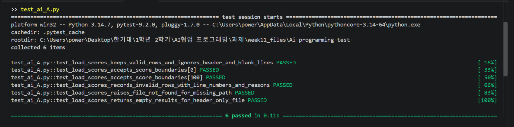
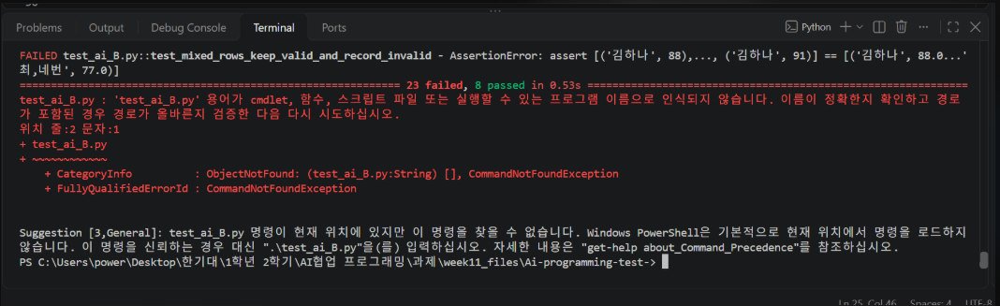

# (프로그램 이름을 적으세요)

점수측정 프로그램

## ① 무엇을 하나요 (What)

성적 CSV 파일을 읽어 0~100점 범위의 유효한 정수 점수를 골라 (이름, 점수) 목록으로 반환하고, 제외한 행은 줄 번호·원본 내용·이유와 함께 기록하는 프로그램이고 pytest를 이용하여 정상 입력·예외 상황·경계값을 검증합니다.


## ② 왜 만들었나요 (Why)          ★ AI는 이 칸을 못 씁니다

--> 성적 CSV 파일에는 이름이나 점수가 비어 있는 행, 숫자가 아닌 점수, 범위를 벗어난 점수 등이 포함될 수 있습니다. 이러한 데이터를 정상 데이터와 구분하고, 잘못된 행을 제외한 이유를 확인할 수 있도록 만들었습니다. 또한 명세서 제공 여부에 따라 테스트의 범위와 결과가 어떻게 달라지는지 비교하고자 했습니다.


## ③ 어떻게 쓰나요 (How)

Python이 설치된 상태에서 VS Code로 프로젝트 폴더를 열고 터미널에서 다음 명령어를 입력합니다. `load_scores.py`, `test_ai_A.py`, `test_ai_B.py`는 같은 폴더에 둡니다.

```bash
# 설치

python -m pip install pytest

# 실행

python -m pytest -v

```

## ④ 어떻게 테스트하나요

```bash
A 테스트는 함수 코드를 바탕으로 정상 입력, 예외 상황, 0점과 100점의 경계값 등을 검사합니다
```
B 테스트는 명세서를 바탕으로 소수 점수, 헤더 오류, 중복 이름, 잘못된 CSV 형식 등 추가 조건까지 검사합니다.
```

test_ai_A.py 통과화면 


test_ai_B.py 통과화면


## ⑤ 파일 구성

| 파일 | 하는 일 |
| --- | --- |
| `load_scores.py` | 성적 CSV 파일을 읽고 유효한 데이터와 제외된 행을 반환하는 함수 |
| `test_ai_A.py` | 함수 코드를 바탕으로 작성한 정상·예외·경계값 단위 테스트 |
| `test_ai_B.py` | 명세서를 바탕으로 작성한 추가 조건을 포함한 단위 테스트 |
| `README.md` | 프로그램의 목적, 실행 방법, 테스트 결과 및 파일 구성 설명 |

## ⑥ 만든 사람 · AI를 어디에 썼는지

- 만든 사람 : 백지원(2026100598)
- AI를 쓴 곳 : A와 B의 pytest 단위 테스트 코드 작성
- 내가 직접 판단한 것 : A와 B의 테스트 실행 결과를 확인하고 성공 및 실패 개수를 비교했습니다. 테스트 개수와 통과 여부를 바탕으로 두 테스트의 검사 범위와 기존 함수의 동작 차이를 비교했고 

## 라이선스

<!-- 저장소를 만들 때 고른 라이선스를 적으세요. 없으면 아무도 이 코드를 쓸 수 없습니다. -->
